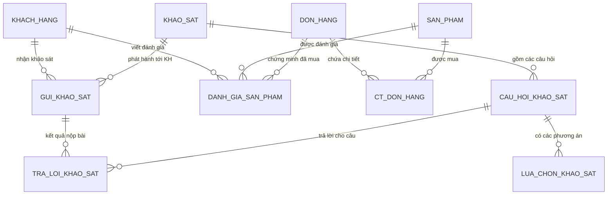
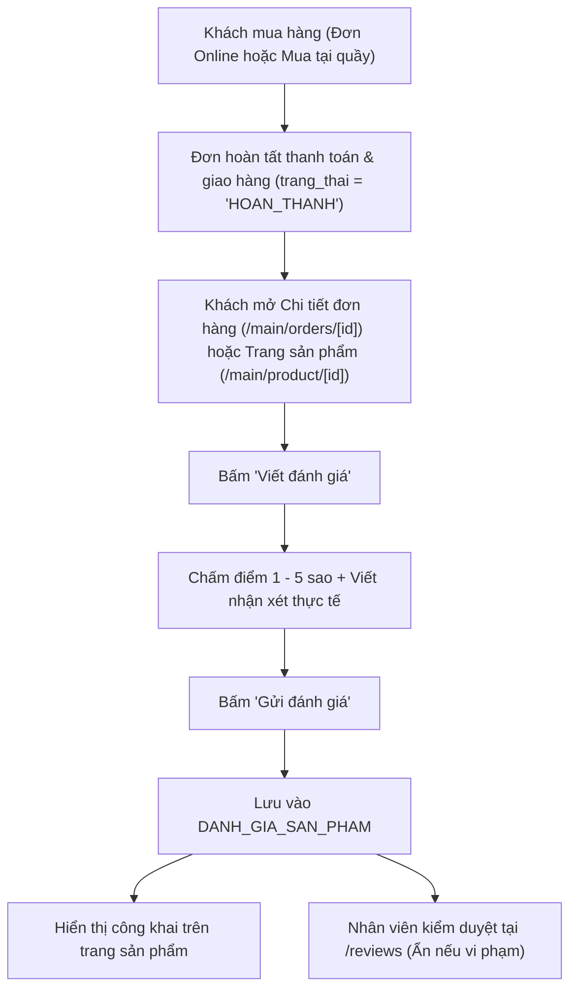

# Hướng dẫn Vận hành Khảo sát Khách hàng & Đánh giá Sản phẩm (CRM)

> **Tài liệu nội bộ nhóm phát triển PHUB Platform**  
> *Phiên bản cập nhật:* Tháng 11/2026  
> *Mục đích:* Làm rõ kiến trúc, ma trận phân quyền, luồng xử lý chi tiết giữa các vai trò (Nhân viên, Admin, Khách hàng), cùng danh mục các nguy cơ tiềm ẩn đã nhận diện và phương pháp khắc phục.

---

## 1. Tổng quan phân hệ & Ma trận phân quyền (Role Matrix)

Phân hệ CRM phục vụ 2 nghiệp vụ cốt lõi:
1. **Khảo sát nhu cầu khách hàng (CRM Surveys):** Thu thập ý kiến, sở thích, định hướng mua sắm của khách hàng.
2. **Đánh giá sản phẩm sau mua (Product Reviews):** Khách hàng đã mua hàng thành công (đơn `HOAN_THANH`) chấm điểm 1–5 sao và gửi nhận xét thực tế.

### Ma trận phân quyền nghiêm ngặt giữa các vai trò

| Chức năng / Tác vụ | Nhân viên (`NHAN_VIEN`) | Quản trị viên (`ADMIN`) | Khách hàng (`KHACH_HANG`) | Vị trí giao diện |
|---|:---:|:---:|:---:|---|
| **Tạo mới / Sửa bản nháp khảo sát** | ✅ Toàn quyền | ❌ Không có quyền | ❌ Không có quyền | Staff Portal: `/surveys` |
| **Xem trước danh sách khách nhận (`preview`)** | ✅ Có quyền | ❌ Không có quyền | ❌ Không có quyền | Staff Portal: `/surveys` |
| **Phát hành & Gửi bài khảo sát (`publish`)** | ✅ Có quyền | ❌ Không có quyền | ❌ Không có quyền | Staff Portal: `/surveys` |
| **Đóng đợt khảo sát (`close`)** | ✅ Có quyền | ❌ Không có quyền | ❌ Không có quyền | Staff Portal: `/surveys` |
| **Xem thống kê chi tiết kết quả khảo sát** | ❌ Chế độ tác nghiệp | ✅ Toàn quyền xem | ❌ Không có quyền | Admin Portal: `/surveys` |
| **Xem Báo cáo phân tích tệp khách hàng** | ❌ Không xem | ✅ Toàn quyền xem | ❌ Không có quyền | Admin Portal: `/crm-report` |
| **Kiểm duyệt đánh giá sản phẩm (Ẩn/Hiện)** | ✅ Có quyền kiểm duyệt | ❌ Không can thiệp | ❌ Không có quyền | Staff/Admin: `/reviews` |
| **Nhận và làm bài khảo sát** | ❌ Không | ❌ Không | ✅ Toàn quyền | User UI: `/main/surveys` |
| **Viết / Cập nhật đánh giá sản phẩm đã mua** | ❌ Không | ❌ Không | ✅ Đã mua đơn hoàn thành | User UI: `/main/product/[id]`, `/main/reviews` |

---

## 2. Kiến trúc Cơ sở dữ liệu (Database Schema)

Cơ sở dữ liệu trên Supabase đã được chuẩn hóa gồm **6 bảng vật lý**, tuân thủ cơ chế bảo mật hàng (RLS) và các hàm thủ tục lưu trữ (RPC PostgreSQL):



### Chi tiết 6 bảng vật lý:
1. **`KHAO_SAT`**: Định nghĩa đợt khảo sát.
   - `ma_khao_sat` (UUID, PK), `tieu_de` (VARCHAR), `mo_ta` (TEXT).
   - `trang_thai`: `NHAP` (đang soạn thảo) $\rightarrow$ `DANG_MO` (đã phát hành tới khách) $\rightarrow$ `DONG` (kết thúc đợt).
   - `loai_doi_tuong`: `TAT_CA` (Mặc định cho toàn bộ khách hàng), `DO_TUOI` (theo khoảng tuổi), `CHUA_NGAY_SINH`.
   - `tuoi_tu`, `tuoi_den`, `han_tra_loi`, `ngay_chot_doi_tuong`, `nguoi_tao`, `phien_ban`.
2. **`CAU_HOI_KHAO_SAT`**: Danh sách câu hỏi trong đợt khảo sát.
   - `ma_cau_hoi` (UUID, PK), `ma_khao_sat` (FK), `noi_dung` (VARCHAR, tối đa 1.000 ký tự).
   - `loai_cau_hoi`: `MOT_LUA_CHON` (trắc nghiệm 1 đáp án), `DIEM_1_5` (chấm điểm sao 1-5), `VAN_BAN` (nhập ý kiến tự do).
   - `nhom_noi_dung`: `SO_THICH` (phân tích sở thích/nhu cầu), `HAI_LONG` (độ hài lòng CSAT), `CHUNG`.
   - `bat_buoc` (BOOLEAN): Đánh dấu câu hỏi bắt buộc trả lời.
   - `thu_tu` (INT): Thứ tự hiển thị câu hỏi (1, 2, 3...).
3. **`LUA_CHON_KHAO_SAT`**: Các phương án trả lời cho câu hỏi trắc nghiệm `MOT_LUA_CHON`.
   - `ma_lua_chon` (UUID, PK), `ma_cau_hoi` (FK), `noi_dung` (VARCHAR).
   - `cho_phep_nhap_khac` (BOOLEAN): Cho phép khách hàng chọn phương án "Khác" và tự điền văn bản.
   - `thu_tu` (INT).
4. **`GUI_KHAO_SAT`**: Phân phối bài khảo sát tới từng khách hàng cụ thể.
   - `ma_gui` (UUID, PK), `ma_khao_sat` (FK), `ma_kh` (FK tới `KHACH_HANG`).
   - `ngay_gui`, `hoan_thanh_luc` (`NULL` nếu chưa nộp, có timestamp khi đã hoàn tất).
   - `khoa_gui_bai` (UUID), `hash_gui_bai` (TEXT mã băm MD5 chống nộp trùng lặp).
5. **`TRA_LOI_KHAO_SAT`**: Dữ liệu câu trả lời của khách hàng.
   - `ma_tra_loi` (UUID, PK), `ma_gui` (FK), `ma_khao_sat` (FK), `ma_cau_hoi` (FK).
   - `ma_lua_chon` (FK nếu là trắc nghiệm), `diem` (INT 1–5 nếu là thang sao), `noi_dung` (TEXT).
6. **`DANH_GIA_SAN_PHAM`**: Đánh giá sản phẩm sau khi mua.
   - `ma_danh_gia` (UUID, PK), `ma_kh` (FK), `ma_sp` (FK), `ma_donhang` (FK chứng minh mua hàng).
   - `so_sao` (INT 1–5), `noi_dung` (TEXT nhận xét thực tế).
   - `trang_thai`: `HIEN_THI` (hiển thị công khai) hoặc `AN` (bị Nhân viên ẩn do vi phạm).
   - `phien_ban` (UUID chống xung đột đồng thời).
   - **Ràng buộc duy nhất:** `UNIQUE (ma_kh, ma_sp)` $\rightarrow$ Mỗi khách hàng có duy nhất 1 đánh giá cho mỗi sản phẩm (hỗ trợ cập nhật).

---

## 3. Luồng xử lý chi tiết

### Luồng 1: Khảo sát thu thập ý kiến khách hàng (CRM Surveys)

```mermaid
sequenceDiagram
    autonumber
    actor Staff as Nhân viên (Staff Portal)
    participant Backend as Backend API / RPC
    participant DB as Database (Supabase)
    actor Customer as Khách hàng (User UI)
    actor Admin as Quản trị viên (Admin Portal)

    Staff->>Backend: 1. Soạn bài khảo sát tại /surveys (Mặc định đối tượng: TAT_CA)
    Backend->>DB: Lưu KHAO_SAT, CAU_HOI_KHAO_SAT (Trạng thái NHAP)
    Staff->>Backend: 2. Xem trước khách nhận (preview) & bấm "Phát hành và gửi khảo sát"
    Backend->>DB: Gọi crm_survey_write_v1('publish'), tạo bản ghi GUI_KHAO_SAT cho khách
    Note over Backend,Customer: Tạm hoãn thông báo tức thời; bài khảo sát ghi nhận sẵn sàng trong DB
    Customer->>Backend: 3. Vào "Khảo sát của tôi" (/main/surveys)
    Backend->>DB: Truy vấn bài khảo sát từ GUI_KHAO_SAT
    Customer->>Backend: 4. Điền form (Kiểm tra câu bắt buộc -> bấm "Gửi bài")
    Backend->>DB: Gọi crm_survey_submit_v1, lưu TRA_LOI_KHAO_SAT, đóng dấu hoan_thanh_luc
    Admin->>Backend: 5. Xem thống kê kết quả tại /surveys (Chế độ xem readOnly) & /crm-report
    Backend->>DB: Gọi crm_survey_read_v1('statistics') tổng hợp dữ liệu
```

#### Bước 1: Nhân viên tạo và soạn thảo khảo sát
1. Nhân viên đăng nhập vào Staff Portal, chọn menu **Khảo sát khách hàng** (`/surveys`).
2. Bấm nút **"+ Tạo khảo sát"**:
   - Nhập Tiêu đề, Mô tả nội dung, Hạn trả lời.
   - **Đối tượng mục tiêu:** Mặc định hệ thống luôn chọn sẵn **`TAT_CA` (Tất cả khách hàng đang hoạt động)**. Nếu có chiến dịch theo độ tuổi, Nhân viên có thể chuyển sang `DO_TUOI` và nhập khoảng tuổi mong muốn.
   - **Thêm danh sách câu hỏi:**
     - Loại `MOT_LUA_CHON`: Thêm các phương án trả lời (có thể tích chọn "Cho phép nhập Khác").
     - Loại `DIEM_1_5`: Đánh giá thang điểm từ 1 đến 5 sao.
     - Loại `VAN_BAN`: Nhập ý kiến tự do.
     - Phân loại nhóm nội dung: `SO_THICH` (sở thích / nhu cầu) hoặc `HAI_LONG` (độ hài lòng CSAT).
     - Tích chọn `Bắt buộc trả lời` cho các câu hỏi quan trọng.
3. Bấm **"Lưu bản nháp"** $\rightarrow$ Dữ liệu được lưu với trạng thái `NHAP`.

#### Bước 2: Nhân viên xem trước và phát hành
1. Nhân viên bấm **"Xem trước khách nhận"** (`GET /api/crm/surveys/{id}/preview`): Hệ thống trả về số lượng khách hàng thỏa mãn điều kiện lọc.
2. Bấm **"Phát hành và gửi khảo sát"** (`POST /api/crm/surveys/{id}/publish`):
   - Hàm RPC `crm_survey_write_v1` quét danh sách khách hàng hợp lệ và chèn các dòng phân phối vào bảng `GUI_KHAO_SAT`.
   - Trạng thái khảo sát chuyển sang `DANG_MO`.
   - Cấu trúc câu hỏi được khóa cứng để đảm bảo tính khách quan của dữ liệu.
   - *Lưu ý về gửi thông báo:* Phần gửi thông báo tức thời (email / notification) đang được tạm hoãn để phát triển sau. Bài khảo sát được lưu vào `GUI_KHAO_SAT` để phục vụ trực tiếp trên giao diện của khách hàng.

#### Bước 3: Khách hàng làm khảo sát
1. Khách hàng đăng nhập vào website khách hàng (`ui/userUI`), vào Hồ sơ cá nhân (`/main/profile`) $\rightarrow$ Click **"Khảo sát của tôi"** (`/main/surveys`).
2. Danh sách khảo sát được gửi tới khách hàng sẽ hiển thị trạng thái (*Chưa gửi bài* hoặc *Đã hoàn thành*).
3. Khách hàng bấm **"Mở khảo sát"**:
   - Form câu hỏi hiển thị dạng thẻ thân thiện trên cả máy tính và di động.
   - **Kiểm soát câu hỏi bắt buộc:** Nếu khách hàng bấm "Gửi bài" mà chưa trả lời câu hỏi bắt buộc (có dấu `*`), hệ thống chặn gửi ngay tại giao diện và hiển thị **cảnh báo đỏ nổi bật** ngay trên nút gửi: *"Vui lòng trả lời câu hỏi bắt buộc: [Tên câu hỏi]"*.
4. Khách hàng điền đầy đủ và bấm **"Gửi bài khảo sát"**:
   - Backend gọi `crm_survey_submit_v1`, lưu kết quả vào `TRA_LOI_KHAO_SAT` và cập nhật `hoan_thanh_luc` trên `GUI_KHAO_SAT`.
   - Khóa Idempotency Key bảo vệ bài làm, ngăn chặn hoàn toàn việc bấm đúp nhiều lần gây trùng lặp dữ liệu.

#### Bước 4: Quản trị viên (Admin) xem thống kê & báo cáo
1. Admin đăng nhập vào Admin Portal, truy cập trang **Kết quả khảo sát** (`/surveys`):
   - Giao diện của Admin tự động kích hoạt chế độ **`readOnly`**: Tiêu đề trang là *"Kết quả khảo sát"*, nút *"+ Tạo khảo sát"* bị ẩn hoàn toàn để đảm bảo Admin không can thiệp vào tác vụ của Nhân viên.
   - Admin bấm vào từng bài khảo sát để xem thống kê trực quan: Tỷ lệ phản hồi, biểu đồ phần trăm lựa chọn của từng câu hỏi trắc nghiệm, điểm sao trung bình và danh sách ý kiến văn bản.
2. Admin truy cập **Báo cáo CRM** (`/crm-report`): Tổng hợp cơ cấu độ tuổi, thị hiếu khách hàng và tương quan giữa các nhóm khảo sát.

---

### Luồng 2: Đánh giá sản phẩm sau khi mua hàng (Product Reviews)



1. **Điều kiện hợp lệ để đánh giá:** Khách hàng bắt buộc phải có ít nhất 1 đơn hàng chứa sản phẩm đó với trạng thái là **`HOAN_THANH`**.
2. **Điểm truy cập:**
   - **Từ Chi tiết đơn hàng (`/main/orders/[id]`):** Với đơn đã `HOAN_THANH`, hệ thống hiển thị khối kêu gọi: *"Đánh giá sản phẩm đã mua - Bạn có thể chấm điểm 1–5 sao và chia sẻ nhận xét thực tế"*.
   - **Từ Trang chi tiết sản phẩm (`/main/product/[id]`):** Khối đánh giá cộng đồng dưới chân trang hiển thị nút *"Viết đánh giá"* nếu khách đã mua sản phẩm này.
3. **Kiểm duyệt đánh giá:** Nhân viên truy cập `/reviews` để rà soát các đánh giá. Nếu phát hiện ngôn từ vi phạm tiêu chuẩn cộng đồng, Nhân viên bấm **"Ẩn"** (`POST /api/crm/reviews/{id}/moderate`). Đánh giá bị ẩn sẽ không hiển thị ra ngoài website khách hàng.

---

## 4. Các nguy cơ tiềm ẩn đã nhận diện & Phương pháp khắc phục

Trong quá trình phân tích và hoàn thiện phân hệ, nhóm phát triển đã xác định **7 nguy cơ tiềm ẩn** và thống nhất giải pháp xử lý triệt để như sau:

---

### Nguy cơ 1: Tiêu chí lọc đối tượng gửi khảo sát bị rỗng hoặc gửi nhầm tệp
- **Vấn đề:** Nếu hệ thống để trống hoặc mặc định tiêu chí lọc quá hẹp (ví dụ lọc theo ngày sinh/độ tuổi mà nhiều khách hàng chưa cập nhật thông tin trong hồ sơ), số lượng khách nhận khảo sát sẽ bằng 0 hoặc rất ít, gây thất bại cho đợt khảo sát.
- **Phương pháp khắc phục:**
  - Thiết lập giá trị mặc định cho mọi đợt khảo sát mới là **`TAT_CA` (Tất cả khách hàng đang hoạt động)**.
  - Nhân viên vẫn có quyền chủ động chuyển sang lọc theo khoảng tuổi (`DO_TUOI`) khi có chiến dịch riêng biệt.
  - Cung cấp nút **"Xem trước khách nhận"** (`preview`) để Nhân viên kiểm tra chính xác số lượng khách hàng trước khi bấm phát hành chính thức.

---

### Nguy cơ 2: Xung đột phiên bản / Race Condition khi sửa đánh giá
- **Vấn đề:** Khách hàng mở 2 tab cùng lúc hoặc sửa đánh giá khi phiên bản ở máy chủ đã thay đổi. Nếu hệ thống tự động ghi đè hoặc âm thầm nạp lại bản mới sẽ gây mất nội dung khách đang viết, tạo trải nghiệm ức chế.
- **Phương pháp khắc phục:**
  - Áp dụng cơ chế **Optimistic Concurrency Control** thông qua trường `phien_ban` (UUID) trong bảng `DANH_GIA_SAN_PHAM`.
  - Nếu phát hiện phiên bản gửi lên không khớp với cơ sở dữ liệu, hệ thống chặn lưu và gửi thông báo rõ ràng cho khách hàng:  
    > *"Đánh giá đã thay đổi. Tải lại trước khi sửa."*  
  - Khách hàng chủ động quyết định tải lại trang để bảo vệ nội dung của mình.

---

### Nguy cơ 3: Khách hàng mua trực tiếp tại quầy thanh toán (POS/Offline)
- **Vấn đề:** Khách mua hàng tại cửa hàng có thể bị hệ thống chặn đánh giá với thông báo *"Bạn chưa có đơn hàng đã hoàn thành cho sản phẩm này"*.
- **Phương pháp khắc phục:**
  - Khi thu ngân tạo và hoàn tất thanh toán trực tiếp tại quầy, hóa đơn và đơn hàng đã được lưu trữ trên hệ thống với trạng thái `HOAN_THANH`.
  - Nếu đơn hàng đã gắn thông tin khách hàng (hoặc sau khi khách liên kết hóa đơn), bảng `CT_DON_HANG` đã ghi nhận đầy đủ các sản phẩm khách đã mua.
  - Do đó, hệ thống xác nhận khách hàng hoàn toàn đủ điều kiện đánh giá sản phẩm bình thường mà không phát sinh bất kỳ lỗi nào.

---

### Nguy cơ 4: Khách hàng bỏ sót câu hỏi bắt buộc trong bài khảo sát
- **Vấn đề:** Khách hàng bấm gửi bài khi chưa điền các câu hỏi quan trọng, dẫn đến dữ liệu khảo sát bị khuyết tật hoặc form bị lỗi mà không rõ nguyên nhân.
- **Phương pháp khắc phục:** Kiểm soát hợp lệ (Validation) 2 lớp:
  - **Lớp Frontend:** Duyệt qua danh sách câu hỏi có cờ `bat_buoc = true`. Nếu phát hiện câu chưa được chọn hoặc chưa nhập văn bản, form lập tức chặn gửi, cuộn màn hình đến câu hỏi đó và hiển thị **cảnh báo đỏ trực tiếp**: *"Vui lòng trả lời câu hỏi bắt buộc: [Tên câu hỏi]"*.
  - **Lớp Backend RPC:** Hàm `crm_survey_submit_v1` đối chiếu lại danh sách câu hỏi bắt buộc. Nếu phát hiện thiếu, transaction sẽ bị rollback toàn bộ và trả về mã lỗi cụ thể.

---

### Nguy cơ 5: Một hóa đơn có nhiều sản phẩm hoặc trùng lặp sản phẩm
- **Vấn đề:** 
  1. Một đơn hàng chứa nhiều sản phẩm khác nhau.
  2. Khách mua nhiều số lượng hoặc mua nhiều dòng cùng 1 SKU trong một đơn hàng.
  3. Khách hàng mua lại cùng 1 sản phẩm qua nhiều đơn hàng khác nhau theo thời gian.
- **Phương pháp khắc phục:**
  - **Nhiều sản phẩm trong 1 đơn:** Hệ thống bóc tách theo từng `ma_sp` trong `CT_DON_HANG` để khách hàng có thể chấm điểm và nhận xét cho từng món riêng biệt.
  - **Mua số lượng nhiều trong cùng 1 đơn:** Sử dụng câu lệnh SQL `DISTINCT ON (p.ma_sp)` để gộp lại thành duy nhất **1 lượt đánh giá**, khách hàng không bị yêu cầu chấm 2 lần cho cùng 1 sản phẩm trong 1 đơn.
  - **Mua lại sản phẩm qua nhiều đơn khác nhau:** Cơ sở dữ liệu áp dụng ràng buộc `UNIQUE (ma_kh, ma_sp)`. Giao diện tự động chuyển sang chế độ **"Cập nhật đánh giá" (Update Review)** để khách hàng chỉnh sửa số sao và nhận xét mới nhất. Đơn hàng đầu tiên vẫn được lưu làm bằng chứng xác thực (`ma_donhang`).

---

### Nguy cơ 6: Thay đổi cấu trúc khảo sát khi đã phát hành hoặc đang có người nộp bài
- **Vấn đề:** Nếu Nhân viên sửa đổi, thêm/xóa câu hỏi hoặc các phương án trắc nghiệm sau khi khảo sát đã phát hành và đã có khách hàng trả lời, toàn bộ dữ liệu thống kê sẽ bị sai lệch cấu trúc và mất tính đồng nhất.
- **Phương pháp khắc phục:**
  - Áp dụng máy trạng thái nghiêm ngặt (Strict State Machine):
    - Trạng thái `NHAP`: Nhân viên toàn quyền thêm, sửa, xóa câu hỏi và phương án.
    - Trạng thái `DANG_MO` (Đã phát hành) và `DONG`: Cấu trúc câu hỏi bị **khóa cứng hoàn toàn (Immutable)**.
  - Nếu muốn thay đổi lớn về mặt nội dung, Nhân viên phải đóng đợt khảo sát cũ và tạo một đợt khảo sát mới.

---

### Nguy cơ 7: Vi phạm ranh giới phân quyền giữa Nhân viên (`NHAN_VIEN`) và Quản trị viên (`ADMIN`)
- **Vấn đề:** Rủi ro Admin can thiệp vào quy trình tác nghiệp tạo/gửi khảo sát, hoặc Nhân viên truy cập vào các số liệu phân tích thị hiếu cấp cao; hoặc lỗi logic phân quyền trên giao diện và API.
- **Phương pháp khắc phục:** Kiểm soát 3 lớp độc lập:
  1. **Lớp Database RPC:** `crm_survey_write_v1` và `crm_review_moderate_v1` sử dụng hàm kiểm tra `admin_ops.staff_actor(p_actor)`. Bắt buộc `role = 'NHAN_VIEN'`. Nếu tài khoản `ADMIN` gọi vào lệnh ghi, Postgres sẽ từ chối ngay lập tức.
  2. **Lớp Backend API:** Service `engagement.py` gọi hàm `self.require_staff()` trước mọi tác vụ ghi khảo sát hoặc duyệt bài đánh giá. Chiều ngược lại, các chế độ xem `statistics` và `report` chỉ cấp phép cho role `ADMIN`.
  3. **Lớp Frontend UI:** Giao diện kiểm tra `portal === "admin"` để tự động chuyển sang chế độ chỉ đọc (`readOnly`), ẩn hoàn toàn nút tạo khảo sát và các thao tác sửa đổi trên Admin Portal.

---

### Nguy cơ 8: Vấn đề N+1 API Requests ngầm trên danh sách khảo sát của Admin
- **Vấn đề:** Trước đây, mỗi thẻ bài khảo sát đã phát hành trên trang danh sách của Admin tự động gửi 1 request độc lập đến `/api/crm/surveys/{id}/statistics` để lấy điểm sao trung bình. Nếu 1 trang có 20 khảo sát đã hoàn thành, trình duyệt sẽ gửi đồng loạt 20 request ngầm gây nghẽn băng thông backend, đồng thời các khảo sát không có câu hỏi chấm điểm 1–5 sao sẽ hiện điểm trống (`—`).
- **Phương pháp khắc phục:**
  - Loại bỏ hoàn toàn việc gọi ngầm API thống kê trên từng thẻ khảo sát ở trang danh sách.
  - Trang danh sách khảo sát chỉ gửi đúng **1 request duy nhất** để lấy toàn bộ danh sách, giúp giao diện tải tức thì (< 50ms) và tuyệt đối ổn định.
  - Khi Quản trị viên muốn xem phân tích, chỉ cần click nút **"Xem kết quả"** là sẽ vào màn hình thống kê chuyên sâu hiển thị đầy đủ tỷ lệ, biểu đồ cột và số sao của từng câu hỏi.

---

### Nguy cơ 9: Nguy cơ nghẽn tải bộ nhớ & lỗi URL khi truy vấn tập đơn hàng lớn (CRM Analytics)
- **Vấn đề:** Trong trang Thống kê khách hàng (`/customer-insights`), hàm `completed_orders` truy vấn danh sách `DON_HANG` và gọi `CT_DON_HANG.in_("ma_donhang", order_ids)`. Nếu số lượng đơn hàng lên đến hàng nghìn đơn, độ dài URL query string vượt quá giới hạn gây lỗi `HTTP 414 URI Too Long`, đồng thời việc gọi lặp lại 2 lần `order_lines` trong cùng một lượt request làm tăng gấp đôi tải database.
- **Phương pháp đã xử lý triệt để trong mã nguồn:**
  1. **Batch Chunking (Chia khối dữ liệu):** Trong [`CrmAnalyticsRepository.order_lines`](file:///c:/Users/Asus/Desktop/Bảo/Tài%20liệu%20trên%20trường/Năm%20Bốn/Học%20Kì%20I/Đồ%20án/Phub-platform-userUI/Phub-platform-userUI/Phub-platform/Backend/phub_api/repositories/crm_analytics.py), áp dụng cơ chế chia nhỏ `order_ids` thành từng khối `CHUNK_SIZE = 150` đơn/lần gọi. Kỹ thuật này triệt tiêu hoàn toàn nguy cơ lỗi HTTP 414 bất kể số lượng đơn hàng lớn đến đâu.
  2. **In-Memory Request Caching:** Tích hợp bộ đệm `_order_lines_cache` theo khóa `tuple(sorted(order_ids))` trong Repository. Khi `completed_orders` đã tính toán tiền đơn hàng, các bước phân tích thị hiếu ngành hàng và sản phẩm tiếp theo trong Service sẽ tái sử dụng ngay kết quả từ bộ đệm, **giảm 50% số lượt gọi database**.
  3. **Định hướng mở rộng dài hạn (Enterprise Scale):** Trong tương lai khi hệ thống đạt quy mô hàng triệu đơn hàng, khuyến nghị chuyển đổi các phép tính tổng hợp `SUM/COUNT/AVG` này thành Database View hoặc RPC gom nhóm trực tiếp bằng SQL trên PostgreSQL.

---

### Lưu ý thực tế về quyền riêng tư của Khách hàng (Ngày sinh / Giới tính):
- Việc khách hàng không cập nhật ngày sinh hoặc giới tính là **hành vi thực tế bình thường** của người dùng mua sắm trực tuyến (bảo vệ thông tin cá nhân), không phải lỗi hệ thống.
- **Xử lý chuẩn mực của hệ thống:**
  - Thống kê khách hàng phân bổ nhóm này vào nhãn **"Chưa có ngày sinh"** và **"Chưa xác định"**, giúp Admin có góc nhìn khách quan về tỷ lệ hồ sơ đầy đủ mà không làm sai lệch tổng số khách hàng.
  - Luồng phát hành khảo sát mặc định tệp đối tượng là **`TAT_CA`**, đảm bảo mọi khách hàng đều nhận được bài khảo sát mà không bị rào cản thông tin hồ sơ.

---

## 5. Danh mục API Backend liên quan

Tất cả các API được quản trị tập trung tại [`phub_api/controllers/engagement.py`](file:///c:/Users/Asus/Desktop/Bảo/Tài%20liệu%20trên%20trường/Năm%20Bốn/Học%20Kì%20I/Đồ%20án/Phub-platform-userUI/Phub-platform-userUI/Phub-platform/Backend/phub_api/controllers/engagement.py):

| Phân hệ | Phương thức | Endpoint | Quyền hạn (Role) | Chức năng nghiệp vụ |
|---|:---:|---|:---:|---|
| **CRM Surveys** | `GET` | `/api/crm/surveys` | `NHAN_VIEN`, `ADMIN` | Lấy danh sách đợt khảo sát (phân trang) |
| **CRM Surveys** | `POST` | `/api/crm/surveys` | `NHAN_VIEN` | Tạo khảo sát nháp mới |
| **CRM Surveys** | `GET` | `/api/crm/surveys/{id}` | `NHAN_VIEN`, `ADMIN` | Xem chi tiết thông tin đợt khảo sát và câu hỏi |
| **CRM Surveys** | `PUT` | `/api/crm/surveys/{id}` | `NHAN_VIEN` | Cập nhật nội dung bản nháp |
| **CRM Surveys** | `GET` | `/api/crm/surveys/{id}/preview` | `NHAN_VIEN` | Xem trước số lượng khách hàng mục tiêu |
| **CRM Surveys** | `POST` | `/api/crm/surveys/{id}/publish` | `NHAN_VIEN` | Phát hành và chèn bản ghi vào `GUI_KHAO_SAT` |
| **CRM Surveys** | `POST` | `/api/crm/surveys/{id}/close` | `NHAN_VIEN` | Đóng bài khảo sát |
| **CRM Surveys** | `GET` | `/api/crm/surveys/{id}/statistics` | `ADMIN` | Xem thống kê số liệu câu trả lời của từng câu hỏi |
| **CRM Analytics**| `GET` | `/api/crm/report` | `ADMIN` | Báo cáo phân tích tổng thể khách hàng & thị hiếu |
| **Product Reviews**| `GET` | `/api/crm/reviews` | `NHAN_VIEN`, `ADMIN` | Xem danh sách đánh giá sản phẩm |
| **Product Reviews**| `POST` | `/api/crm/reviews/{id}/moderate` | `NHAN_VIEN` | Ẩn hoặc cho phép hiển thị lại đánh giá vi phạm |
| **User Customer** | `GET` | `/api/customer/crm/surveys` | `KHACH_HANG` | Lấy danh sách khảo sát được gửi tới tài khoản |
| **User Customer** | `GET` | `/api/customer/crm/surveys/{id}` | `KHACH_HANG` | Mở bài khảo sát để điền |
| **User Customer** | `POST` | `/api/customer/crm/surveys/{id}/submit` | `KHACH_HANG` | Nộp toàn bộ bài làm khảo sát |
| **User Customer** | `GET` | `/api/customer/crm/reviews/eligible` | `KHACH_HANG` | Danh sách sản phẩm trong đơn đã mua đủ điều kiện đánh giá |
| **User Customer** | `POST` | `/api/customer/crm/reviews` | `KHACH_HANG` | Viết mới hoặc cập nhật đánh giá sản phẩm |
| **Public Catalog** | `GET` | `/api/catalog/products/{id}/reviews` | Công khai | Hiển thị điểm sao và nhận xét công khai trên website |

---

## 6. Hướng dẫn Kiểm thử & Nghiệm thu (Testing Guide)

### 1. Kiểm thử tự động (Automated Test Suite)
```powershell
# Chạy toàn bộ test suite kiểm tra Backend phân hệ CRM & Phân quyền:
pytest Backend/tests/test_engagement.py Backend/tests/test_crm.py Backend/tests/test_crm_analytics.py Backend/tests/test_counter_buyer_email.py

# Kiểm tra OpenAPI schema contract:
pytest Backend/tests/test_openapi.py

# Kiểm tra tính toàn vẹn kiểu dữ liệu TypeScript của Frontend:
cd ui/userUI/Frontend ; npx tsc --noEmit
cd ../../adminUI ; npx tsc --noEmit
```

### 2. Kịch bản kiểm thử quy trình thực tế (Manual E2E)
1. **Kiểm thử phân quyền Nhân viên tạo & gửi khảo sát:**
   - Đăng nhập tài khoản Nhân viên (`NHAN_VIEN`) tại Staff Portal (`/surveys`).
   - Bấm **"+ Tạo khảo sát"** $\rightarrow$ Tạo 1 câu trắc nghiệm `SO_THICH`, 1 câu chấm điểm sao `HAI_LONG` có tích `bat_buoc = true` $\rightarrow$ Lưu nháp.
   - Bấm **"Xem trước khách nhận"** $\rightarrow$ Thấy số lượng khách.
   - Bấm **"Phát hành và gửi khảo sát"** $\rightarrow$ Bài khảo sát chuyển sang trạng thái `DANG_MO`.
2. **Kiểm thử Khách hàng làm bài & Xử lý câu hỏi bắt buộc:**
   - Đăng nhập tài khoản Khách hàng trên web khách hàng (`ui/userUI`).
   - Vào Hồ sơ cá nhân $\rightarrow$ Mở **"Khảo sát của tôi"** (`/main/surveys`).
   - Thử bấm "Gửi bài" khi chưa chọn câu hỏi bắt buộc $\rightarrow$ Form chặn gửi và hiện cảnh báo đỏ nổi bật.
   - Điền đầy đủ câu hỏi $\rightarrow$ Bấm gửi thành công.
3. **Kiểm thử Admin xem báo cáo thống kê:**
   - Đăng nhập tài khoản Quản trị viên (`ADMIN`) tại Admin Portal (`/surveys`).
   - Xác nhận: Trang mang tiêu đề *"Kết quả khảo sát"*, không có nút tạo khảo sát.
   - Bấm vào bài khảo sát vừa hoàn thành $\rightarrow$ Xem tỷ lệ hoàn thành, biểu đồ phần trăm lựa chọn và điểm sao trung bình.
4. **Kiểm thử Đánh giá sản phẩm đã mua:**
   - Sử dụng tài khoản khách hàng có đơn hàng đã hoàn tất (`HOAN_THANH`).
   - Mở trang chi tiết sản phẩm $\rightarrow$ Viết đánh giá 5 sao $\rightarrow$ Bấm gửi.
   - Đăng nhập tài khoản Nhân viên vào `/reviews` $\rightarrow$ Bấm "Ẩn" đánh giá $\rightarrow$ Quay lại trang sản phẩm xác nhận bình luận đó đã được ẩn.

---

## 7. Các cam kết kỹ thuật quan trọng
1. **Bảo toàn DDL Database:** Không tạo thêm bảng ngoài 6 bảng vật lý đã chuẩn hóa trên Supabase. Mọi nghiệp vụ phải đi qua các hàm RPC đã kiểm thử.
2. **Phân quyền bất di bất dịch:** Nhân viên phụ trách vận hành nghiệp vụ (tạo/gửi khảo sát, duyệt đánh giá); Admin phụ trách giám sát dữ liệu và phân tích báo cáo thống kê.
3. **Trải nghiệm khách hàng:** Giữ tính minh bạch, hiển thị thông báo rõ ràng khi có xung đột dữ liệu hoặc thiếu sót thông tin, không ngầm xóa hoặc ghi đè dữ liệu của khách hàng.
